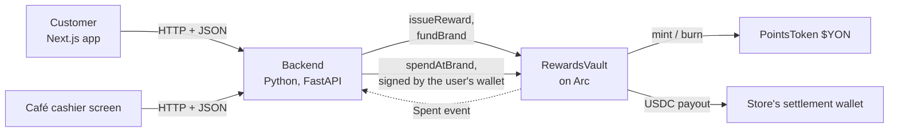

# Yonder

**Rewards points that travel across borders, backed by USDC on Arc.**

Earn points shopping online in the US, then pay with them at a café counter in Singapore. The café is paid in seconds, and neither the customer nor the brands ever touch crypto.

Demo video: https://www.youtube.com/watch?v=Zvspf0ETdwg

Main track: **Consumer Applications** · Chain award: **Best use of Arc**

---

## The problem

Big brands run a separate loyalty program in every country. Points earned at a coffee chain in Singapore can't be used at the same chain in the US. Travelers, expats and international students lose value every time they cross a border, and brands lose their most mobile customers.

## What we built

Yonder is a rewards network where each brand's points work in every country that brand operates in.

- **Earn anywhere.** Pay by card as usual at a member store. Points arrive within seconds.
- **Spend anywhere.** At 100 points, they're worth real money ($1 per 100 points) at any of the brand's stores, in any country.
- **Pay in store with a code.** The cashier's screen shows a 6-character code. Type it in the app, tap **Pay with points**, and the cashier's screen turns green.
- **Brands get paid instantly.** Each payment settles to the store in USDC within one block, and the store receives its local currency.

The demo program is **Treehouse Rewards**: Treehouse Supply Co. (online store, United States) and Treehouse Café (Orchard Road, Singapore).

### Crypto stays invisible

The Consumer track asks for apps where the blockchain disappears. In Yonder:

- Login is just a name and email. There's no wallet to install, no seed phrase and no popup.
- Users never pay or see gas fees. The network covers them.
- The app talks about **points** and **dollars**, never tokens or chains.
- Brands fund rewards and get paid in their own currency. USDC only moves inside the network.

## How it works



1. **Earn.** A customer buys a $50 jacket at Treehouse Supply Co. The backend calls `issueReward`, which takes $0.50 of USDC from the brand's reward budget in the vault and mints 50 points.
2. **Pay.** At Treehouse Café, the cashier rings up S$1.35 (US$1.00). The customer enters the order code and pays with 100 points. The backend sends `spendAtBrand` from the customer's own wallet, so only their points can be burned. The vault burns the points and sends $1.00 USDC to the café's settlement wallet.
3. **Confirm.** The backend watches for the vault's `Spent` event, matches it to the order and marks it paid. The cashier's screen turns green.
4. **Pay out.** The backend converts at a fixed demo rate and logs the café's payout of S$1.35.

### The rules, enforced onchain

- **Every point is backed.** Each point is backed by $0.01 of USDC locked in the vault, and no point can be minted without it. Anyone can check this with the vault's `isFullyBacked()`.
- **Points only work at registered brands.**
- **Each order can be paid once.**
- **Only the customer's own wallet can spend their points.** Customers can't transfer points to each other.

## How we use Arc

| | |
|---|---|
| **Network** | Arc testnet (chain ID 5042002) |
| **RewardsVault** | [`0x14a418200Ead51F6304eC090A5867f7552A76584`](https://testnet.arcscan.app/address/0x14a418200Ead51F6304eC090A5867f7552A76584) |
| **PointsToken ($YON)** | [`0xfc7f3FcDc7b09291C7F3df1a6FcCc953f3460DFa`](https://testnet.arcscan.app/address/0xfc7f3FcDc7b09291C7F3df1a6FcCc953f3460DFa) |
| **USDC** | `0x3600000000000000000000000000000000000000` (Arc's USDC) |

- **USDC is the money and the gas.** Rewards are backed by USDC, stores are paid in USDC, and every fee is paid in USDC. The network's costs are in dollars and never depend on a volatile token's price.
- **Cross-border settlement in one block.** A Singapore café is paid by a US-funded reward budget in about a second, with no bank wire in between.
- **Verifiable backing.** Anyone can open the vault on the explorer and check its USDC balance against `totalLiabilities()`.
- **Standard EVM tooling.** The contracts are Solidity with OpenZeppelin, built, tested and deployed with Foundry.

Every transaction in the app has a **Verify onchain** link to the Arc explorer.

## What's real and what's simulated

| Part | In the demo |
|---|---|
| Contracts on Arc testnet: earning points, paying with points, settling to the store | **Real** transactions |
| Cashier screen turning green | **Real**, driven by the onchain `Spent` event |
| Email login, one wallet per user | **Real** wallets, held by the backend for the demo |
| Card payments at the stores | Simulated |
| Brands funding rewards in USD | Simulated: the network wallet funds the brand's USDC budget |
| Payout to the store in local currency | Simulated with a fixed exchange rate, shown on the Brand payouts screen |

## What makes it different

- **Points travel; existing programs don't.** Most loyalty programs stop at the border. Yonder's rewards work in every country a brand operates in.
- **Backing you can verify.** Most loyalty points are an unbacked promise. Every $YON point is backed by USDC that anyone can see.
- **One network, many programs.** Each brand runs its own program on shared infrastructure, from a global chain down to a group of independent cafés that pool their rewards.

## Business model

Brands are the paying customers. Yonder takes a small fee on each settlement, like a card network. Further revenue can come from a monthly brand subscription and a margin on currency conversion. Users never pay fees.

## What's next

- **More programs.** The app already includes a program switcher, with other programs marked "coming soon."
- **Circle Wallets and Gas Station**, so Circle holds each user's keys and sponsors their fees.
- **Real local-currency payouts** through an off-ramp partner.
- **Live exchange rates**, instead of the fixed demo rate.
- **A brand dashboard** with reward budgets, settlements and the share of customers from abroad.

## Run it yourself

The repo has three parts: [`contracts/`](contracts/) (Solidity, Foundry), [`backend/`](backend/) (Python, FastAPI, web3.py) and [`web/`](web/) (Next.js). Each folder has its own README with details.

You need Python 3.11+ and Node.js 20+. Foundry is only needed for the contracts.

```bash
git clone --recurse-submodules https://github.com/zhun777/UBC-Hack-2026.git
cd UBC-Hack-2026
```

**Backend** (http://localhost:8000, API docs at `/docs`):

```bash
cd backend
python3 -m venv .venv
.venv/bin/pip install -r requirements.txt
cp .env.example .env
.venv/bin/uvicorn main:app --reload
```

With the default `CHAIN_MODE=fake`, the backend runs without any keys or blockchain, so you can try the whole app immediately. To use the deployed contracts on Arc testnet, set `CHAIN_MODE=arc` and set `NETWORK_PRIVATE_KEY` to the vault owner's key. See [backend/README.md](backend/README.md).

**Frontend** (http://localhost:3000), in a second terminal:

```bash
cd web
npm install
echo "NEXT_PUBLIC_API_URL=http://localhost:8000" > .env
npm run dev
```

**Try the demo:**

1. Log in with any name and email.
2. Go to **Stores → Treehouse Supply Co.** and buy the jacket twice. You now have 100 points.
3. In a second tab, open the **Café cashier** (link at the bottom of the home screen), add a Kopi and tap **Request payment**.
4. Back in the first tab, go to **Pay**, enter the code and tap **Pay with points**. The cashier's screen turns green.
5. Open **Brand payouts** to see the café's payout.

**Tests:**

```bash
cd contracts && forge test        # 35 tests, including a fuzzed backing invariant
cd backend && .venv/bin/pytest    # 25 tests
```

## Team

- Alan Khinkis: smart contracts
- Chris Yun: backend
- Enqi Zhu: frontend
